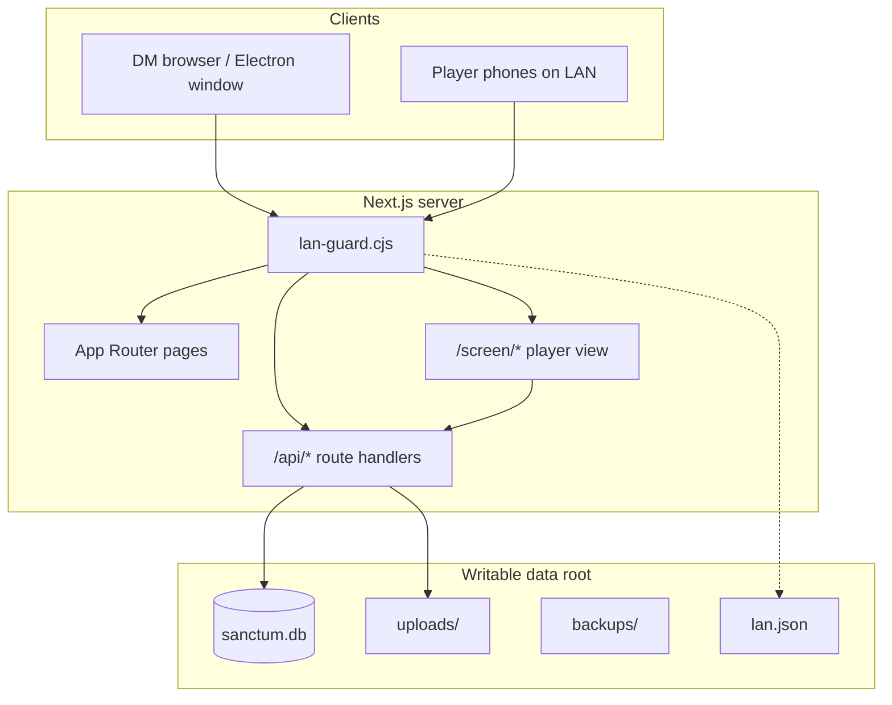

# Architecture

Sanctum is a **local-first D&D 5e campaign manager** for a single Dungeon Master. All campaign data lives in one SQLite database on the DM's machine. There is no cloud account and no remote multi-user auth. An optional Electron shell packages the same Next.js server as a desktop app.

## Goals

- **Primary goal:** Give a DM a fast, offline campaign toolkit (characters, combat, battle map, world atlas, prep) with data that never leaves the machine unless the DM opts into LAN player view or export.
- **Non-goals:** Multi-DM collaboration, hosted SaaS, accounts, AI generation, cross-machine sync, or exposing the full DM app over the network.

## High-level diagram

## Components

| Component | Responsibility | Notes |
|-----------|----------------|-------|
| Next.js App Router | DM UI, player screen, uploads route | `src/app/` |
| API routes | CRUD and special ops (import, search, LAN, screen) | `src/app/api/`; wrapped by `apiRoute` in `src/lib/api.ts` |
| Domain lib | Combat, dice, generators, atlas, PDF, search, validators | `src/lib/` |
| Drizzle + better-sqlite3 | Schema, migrations, WAL SQLite | `src/db/`, migrations in `drizzle/` |
| Feature UI | Domain components + shadcn primitives | `src/components/` |
| LAN guard | Gate non-loopback requests to player view + token | `scripts/lan-guard.cjs`; loaded from `next.config.ts` or `scripts/sanctum-server.cjs` |
| Electron shell | Spawn standalone server, set data root, bind host | `electron/main.js` |
| Desktop build | Standalone Next + electron-builder | `scripts/build-desktop.mjs`, `electron-builder.yml` |

## Runtime modes

| Mode | How it runs | Data root | Bind |
|------|-------------|-----------|------|
| `npm run dev` / `npm start` | Next in project cwd | `process.cwd()` unless `SANCTUM_DATA_ROOT` | localhost; `start:lan` uses `0.0.0.0` |
| Packaged Electron | Spawns `sanctum-server.cjs` (standalone Next) | OS userData (`%APPDATA%\Sanctum`, etc.) | `127.0.0.1` or `0.0.0.0` from `lan.json` |
| Electron unpackaged | Loads existing `next dev` on `:3000` | project cwd | whatever Next is using |

Paths are centralized in `src/lib/paths.ts`: `data/sanctum.db`, `backups/`, `uploads/`, migrations via `SANCTUM_MIGRATIONS_DIR` when packaged.

## Request / data flow

1. HTTP hits the process; `lan-guard` decides allow/deny from **socket remote address** (never client-supplied forwarded headers for trust).
2. Loopback gets the full DM app. Other devices only get player view surfaces when sharing is on and the share token/cookie matches (see `SECURITY.md`).
3. Route handlers use Zod (`src/lib/validators.ts`) and often `collectionHandlers` / `itemHandlers` (`src/lib/crud.ts`).
4. Writes go to SQLite; non-GET API calls mark global search stale (`src/lib/search/stale.ts`).
5. Player payload is filtered in `src/lib/screen/state.ts` (HP bands, fog, hidden tokens).

## Boundaries

- **External dependencies (optional):** GitHub Releases API for opt-in update check (`src/lib/update-check.ts`). Off by default; no campaign data sent.
- **Public network surface:** Only the LAN player view when enabled. Full DM APIs are local-only by design.
- **Content:** Bundled SRD-derived monsters/spells; DM uploads and homebrew stay on disk.

## Key decisions

| Date | Decision | Status |
|------|----------|--------|
| — | Local SQLite (`better-sqlite3`) + Drizzle instead of a hosted DB | accepted |
| — | Next.js App Router + React 19 for UI and API colocation | accepted |
| — | Electron wraps standalone Next output; same codebase for web and desktop | accepted |
| — | Network isolation via pre-Next HTTP guard + share token, not app-level auth | accepted |
| — | Theme/locale in cookies (not localStorage) so desktop port changes keep settings | accepted |
| — | JSON columns use real JS defaults (`.default([])`), never stringified JSON | accepted — see `docs/JSON_COLUMN_DEFAULTS_FIX.md` |

## Code map (where to look)

| Concern | Start here |
|---------|------------|
| Schema / tables | `src/db/schema.ts` |
| DB open + auto-migrate + backup | `src/db/index.ts` |
| API helpers / CRUD | `src/lib/api.ts`, `src/lib/crud.ts` |
| LAN config / URLs / firewall | `src/lib/lan.ts`, `scripts/lan-guard.cjs` |
| Player view state | `src/lib/screen/state.ts`, `src/app/api/screen/` |
| Campaign export/import / sample | `src/lib/campaign-data.ts`, `src/lib/sample-campaign.ts` |
| Search | `src/lib/search/` |
| Combat / battle map | `src/lib/combat-*.ts`, `src/lib/battle-map.ts`, `src/components/combat/` |
| Generators | `src/lib/generators/` |
| i18n | `src/lib/i18n/` |
| Themes | `src/lib/themes.ts`, `src/app/globals.css` |

## Evolution

- **Current phase:** Shipped desktop product (v1.x on itch.io) with ongoing feature work.
- **Known limitations:** Single-machine DM; Windows release builds are local (CI covers Linux/macOS); no automated unit/e2e suite yet; polymorphic owned rows (spells/inventory) cascade in app code, not FKs.
